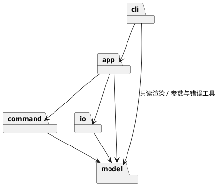

# Lab1 Phase 1：SVG 编辑器（CLI）

> **Git 仓库地址：<https://github.com/ikou11/svg-editor>**
> 最终提交 tag：`final`

技术栈：TypeScript（strict）+ 面向对象；运行时依赖为零，开发依赖为 `typescript` / `tsx` / `vitest`。

```bash
npm install
npm run cli       # 启动 REPL，提示符 svg>
npm test          # 运行全部测试
npm run typecheck # 类型检查
```

---

## 1. 架构方案

### 1.1 模块划分

```
src/
├── model/     图形领域模型（Composite）
├── command/   编辑命令与撤销重做（Command）
├── io/        SVG 文件的序列化 / 解析 / 读写
├── app/       应用层：Editor（当前文档 + 历史 + io 锁）
└── cli/       命令行界面：REPL、命令分发、文本渲染
```

| 模块 | 职责 | 主要类（一类一文件，文件名 = 类名） |
|---|---|---|
| `model` | 文档与图形树。不知道命令、文件、终端的存在。图形自己负责几何操作（move/scale/set）、快照（memento）与自描述（标签名、属性、tree 中的摘要）。 | `Shape`（抽象组件）、`LeafShape`、`Rect`、`Circle`、`Ellipse`、`Line`、`Text`、`Group`（容器）、`Document`（画布 + 根容器 + 查找）、`ShapeFactory`（类型名→创建函数注册表）、`Style`、`SvgAttrs`、`ArgReader`、`NumberFormat`、`SvgError`、`ShapeMemento` |
| `command` | 每个编辑动作是一个可执行、可撤销的对象；`History` 管理两个栈。命令只依赖 `model`。 | `Command`（接口）、`History`、`CreateCommand`、`DeleteCommand`、`ShapeMutationCommand`（模板基类）→ `MoveCommand` / `ScaleCommand` / `SetCommand`、`GroupCommand`、`UngroupCommand`、`AddToCommand`、`ZOrderCommand` |
| `io` | 文档 ↔ SVG 文本。`SvgWriter` 只读 `Shape` 的自描述接口；`SvgReader` 经 `ShapeFactory` 构造图形，缺 id 时补 id 并产生警告。 | `SvgWriter`、`SvgReader`、`SvgReadSession`、`XmlParser`、`XmlNode`、`FileStore`（隔离 `fs`） |
| `app` | 应用门面：持有当前 `Document`、`History`、"io 命令后禁止 undo"标志；把界面层请求翻译成 `Command`。 | `Editor` |
| `cli` | 唯一接触终端的模块：读行、切分参数、按命令名分派、渲染输出。 | `Repl`、`ReplSession`、`LineTokenizer`、`CommandInterpreter`、`CommandRegistry`、`CliCommand`（抽象）及 `XxxCliCommand` 各命令、`TreeRenderer`、`ShowRenderer`、`CliApplication`（装配）、`main.ts`（入口） |

组件图：



核心类图（Composite + Command）：

```plantuml
@startuml
abstract class Shape {
  id; parent
  move(dx, dy); scale(f)
  get(attr); set(attr, v)
  memento(): ShapeMemento
  describe(); svgAttributes()
}
abstract class LeafShape
class Group { children; add(); remove() }
Shape <|-- LeafShape
Shape <|-- Group
LeafShape <|-- Rect
LeafShape <|-- Circle
LeafShape <|-- Ellipse
LeafShape <|-- Line
LeafShape <|-- Text
Group o-- Shape : children

interface Command { execute(); undo() }
class History { run(); undo(); redo() }
abstract class ShapeMutationCommand
Command <|.. CreateCommand
Command <|.. DeleteCommand
Command <|.. GroupCommand
Command <|.. UngroupCommand
Command <|.. AddToCommand
Command <|.. ZOrderCommand
Command <|.. ShapeMutationCommand
ShapeMutationCommand <|-- MoveCommand
ShapeMutationCommand <|-- ScaleCommand
ShapeMutationCommand <|-- SetCommand
History o-- Command

class Editor
Editor --> History
Editor ..> Command : 构造
@enduml
```

### 1.2 设计模式的选择与落地

| 模式 | 用在哪 | 落地方式 |
|---|---|---|
| **Command（必须）** | 所有编辑命令的执行与撤销 | `Command` 接口：`execute()` / `undo()`，各返回一行用户反馈。命令在**构造时完成全部校验**（失败即抛 `SvgError`，文档不受影响），`execute`/`undo` 只做状态变更。`History` 持有 undo / redo 两个栈，`run()` 新命令时清空 redo 栈；redo 即再次 `execute`。`group g1 a b c` 是单个 `GroupCommand`，天然是一个 undo 单元。`delete` 记录原父容器与原下标，撤销时放回原位。 |
| **Memento** | 撤销"改属性"类命令 | `Shape.memento()` 返回可还原几何/样式/文本的快照；`ShapeMutationCommand`（Template Method）执行前取快照、撤销时整体还原。不用"反向运算"（如 `scale 1/f`），避免浮点误差。 |
| **Composite** | 图形树 | `Shape` 为抽象组件，`LeafShape` 为叶子，`Group` 为容器。`move/scale/set/memento` 在 `Group` 中递归子节点，所以命令类里没有任何容器/叶子判断。 |
| **Factory（注册制）** | 按类型名创建图形 | `ShapeFactory` 内部是 `Map<类型名, 创建函数 + SVG 读取函数>`，通过 `register()` 加入，不是 `switch`。 |
| **自描述（替代 Visitor / switch）** | 序列化与 tree/show | `Shape` 提供 `tag`、`svgAttributes()`、`textContent()`、`describe()` 等多态方法，`SvgWriter` / `TreeRenderer` / `ShowRenderer` 只调用它们。不选 Visitor，是因为 Visitor 每新增一种图形就要改访问者接口，与下阶段"插件新增 `box`、内核改动为 0"冲突。 |
| **Facade** | `Editor` | cli 只和 `Editor` 打交道，不直接创建 `Command`、不碰文件。 |

**按名字分派的位置（作业要求只允许两处，均为待重构项）：**

1. **命令分发**：`cli/CommandRegistry` 中 `命令名 → CliCommand`。*待重构*：命令自描述并自动注册，help 由注册信息生成。
2. **图形工厂**：`model/ShapeFactory` 中 `类型名 → 创建/读取函数`。*待重构*：下阶段升级为 `ShapeProvider` 插件接口（类型名 + 参数 schema + 序列化标记 + 读回还原）。

这一点由 `test/architecture/ArchitectureRules.test.ts` 自动检查：除这两个文件外，不允许出现以名字为键的分派表，也不允许出现 `switch` 或对图形类型的 `instanceof`。

### 1.3 依赖方向规则

```
cli ──> app ──> command ──> model
         │                    ▲
         └──────> io ─────────┘
cli ──> model（只读渲染 + 参数/错误工具）
```

| 规则 | 理由 |
|---|---|
| `model` **不依赖任何其他模块** | 领域核心可独立测试、复用；图形不应知道命令、文件格式或终端。 |
| `command` 只依赖 `model` | 命令是对模型的操作，不关心输入来自 CLI 还是别的界面，也不读写文件。 |
| `io` 只依赖 `model` | 文件格式是模型的外部表示；换格式不应触及命令或界面。`io` 与 `command` **互不依赖**。 |
| `app` 可依赖 `command`、`io`、`model`，**不依赖 `cli`** | `app` 是不含终端细节的应用核心，可被别的界面复用。 |
| `cli` 依赖 `app` 与 `model`；**不得依赖 `command` / `io`，不得直接使用 `fs`** | 最外层。必须经 `Editor` 间接创建命令与读写文件。 |
| 内层不得依赖外层；模块间**无循环依赖**；只有 `io/FileStore` 使用 `fs`，只有 `cli/Repl`、`cli/main` 接触终端 | 变更方向单一，便于抽样检查。 |

以上规则全部由 `ArchitectureRules.test.ts` 自动检查（读取所有 `src` 文件的 import 语句）。检查本身经过变异验证：往 `model` 里人为加一条指向 `cli` 的 import，测试会失败（见"过程记录"）。

### 1.4 变化点假设

| # | 最可能的变化 | 为它留了什么 | 或：为何不留 |
|---|---|---|---|
| 1 | **新增图形类型**（下阶段 `box` 复合图形，由插件提供） | `ShapeFactory` 注册制（同时注册创建函数与 SVG 读取函数）+ `Shape` 自描述接口；命令、序列化、tree 渲染都不按类型分支。下阶段把工厂升级为 `ShapeProvider` 即可。尚缺的钩子（`ungroup` 拒绝复合图形、`set` 传播语义、tree 类型标注）在 §5 列为已知缺口。 | — |
| 2 | **新增编辑命令** | `Command` 接口 + `CommandRegistry` 注册；新增一个命令类并注册即可。 | — |
| 3 | **文件格式变化**（如改存 JSON） | `io` 模块独立；`Editor` 只依赖 `SvgReader` / `SvgWriter` / `FileStore` 的窄接口。 | — |
| 4 | **用户界面变化**（GUI / 脚本 / agent 调用） | `app.Editor` 不含终端细节，CLI 只是它的一个前端。 | — |
| 5 | **更精细的 undo 粒度**（如命令合并） | `History` 以 `Command` 为单位，新命令类可在内部组合多步。 | 原计划的 `CompositeCommand` 未实现：当前所有多步操作（group 等）都能放进单个命令类，提前抽象没有使用者。 |
| 6 | **图形增加样式属性**（opacity 等） | 样式集中在 `Style` 类，增加属性只改这一个类的白名单。 | 不做通用属性包：作业只要求 fill/stroke/stroke-width，万能 `Map` 会削弱封装。 |
| 7 | **按路径（XPath 式）寻址图形** | 暂不留。 | 作业明确本阶段只用 id；若需要，只影响 cli 解析层与 `Document` 的查找方法。 |
| 8 | **读入更多 SVG 元素**（path、transform 等） | 读入时遇到不支持的元素给出警告并跳过，不会静默丢失。 | 不做：超出作业范围，且需要新增图形类型。 |

### 1.5 作业中未明确、由我自行决定的行为

| 情形 | 决定 |
|---|---|
| `group` 新容器的位置与子节点顺序 | 新容器放在"文档顺序最靠前的成员"原来的位置；子节点保持文档顺序，与命令行参数顺序无关。 |
| 对 `g` 执行 `set` | 只接受 `fill` / `stroke` / `stroke-width`，并应用到所有子孙；对容器设几何属性报 `unknown attribute`。 |
| `line` 的颜色参数 | 对应 `stroke`（line 没有填充）。`tree` 中 line 的摘要不显示 stroke，与示例一致。 |
| tree 的属性列对齐 | 全树属性列对齐，位置 = 最宽"前缀+标签"+2 个空格。该规则精确重现 §5.1 与 §6 的示例；§6.1 示例中手工对齐前后不一致，对应的回放测试忽略连续空格的差异。 |
| 读入不支持的元素 / `<g transform>` | 打印 `warning: skipped unsupported <path>` / `warning: ignored transform on ...`，继续读入。 |
| `init` / `canvas` 只给一个参数 | 宽度生效，高度取默认值 / 保持当前值。 |
| `save` 无参数且从未 read/save | `error: no file path. use 'save <file>'`；`save <file>` 之后该路径成为新的默认路径。 |
| 空栈时 undo / redo | `error: nothing to undo` / `error: nothing to redo`。 |
| 额外命令 | `exit`（退出 REPL）。 |

---

## 2. 过程记录

> 以下是开发中实际发生的、我认为有代表性的问题与迭代；每条都有对应的修复和验证。

**① 设计阶段比较了 Visitor 与"图形自描述"，选了后者。**
序列化和 tree 渲染最常见的做法是 Visitor。但对照"下阶段 `box` 插件、内核新增 0 行"的目标，Visitor 每新增一种图形都要修改访问者接口，与目标冲突。因此让 `Shape` 自描述（`svgAttributes()`、`describe()`、`textContent()`），渲染器只调用多态方法。第 1.2 节记录了这个取舍，`ArchitectureRules` 测试保证代码里没有按类型分支。

**② 撤销用快照而不是反向运算（设计时预判，并用测试固定）。**
`scale` 的撤销若做 `scale(1/f)`，`scale 0.1` 再 `scale 10` 在浮点下不会回到原值。所以一开始就采用 Memento：执行前取快照，撤销时直接还原。这是预判而非实际踩坑；测试 `scales a container recursively and undo restores exact values` 用 `0.1` 因子把它固定下来。

**③ 一次提交时类型检查其实是失败的，是我的流程有漏洞。**
我用 `npm run typecheck | tail` 看结果，管道使得整条命令的退出码来自 `tail`，于是 `&&` 之后的 `git commit` 照常执行——`GroupCommand` 里一个未使用的字段 `doc` 报了 TS6138，却被提交了。发现后修复并重写了那个尚未推送的提交，此后检查类型时不再经过管道。教训：**验证命令的退出码不能被管道吞掉。**

**④ 批量重命名没有生效，但测试照样通过。**
把 cli 命令类统一改名为 `XxxCliCommand` 时，我用了 `sed 's/\bInitCommand\b/.../'`。macOS 自带的 BSD `sed` 不支持 `\b`，所以文件改名了、类名没改。更隐蔽的是，改名后测试仍然全绿（旧类名在文件内部一致）。是随后 `grep "class .*Command"` 看到文件名与类名不一致才发现，改用 `perl -pe` 重做，并由 `ArchitectureRules` 里的"一类一文件、文件名=类名"检查兜底。

**⑤ 架构检查测试本身有漏洞，是靠"变异验证"发现的。**
写完 `ArchitectureRules.test.ts` 全部通过后，我没有直接相信它：往 `src/model/SvgError.ts` 人为追加一行 `import "../cli/Repl.js"`（一条违反依赖规则的副作用 import），测试**依然全绿**。原因是正则只匹配了 `from "../x/` 形式。改为匹配所有以 `"../` 开头的字符串后，同样的注入会让测试失败，然后还原注入。教训：**一个从未失败过的检查，不能说明它有用。**

**⑥ 作业示例之间自相矛盾，需要先判断哪个是规则、哪个是笔误。**
§5.1、§6 的 tree 属性列是全局对齐的，而 §6.1 的树按兄弟节点对齐且间距不一致（`rect#process` 后 5 个空格、`text#process-label` 后 1 个空格）。我选择能精确重现 §5.1 与 §6 的"全树对齐"规则，并在测试里对 §6.1 忽略连续空格，同时在 §1.5 明确记录这个决定。

**⑦ 作业未规定的边界，选择"显式告知"而不是静默处理。**
例如读入 `<path>`、带 `transform` 的 `<g>`：直接丢弃会让用户以为文件被完整读入。改为打印 `warning:` 并跳过，列入 §1.5。

---

## 3. 一致性自查

### 3.1 模块划分：实际目录与方案是否一致？

**目录一致**：`src/` 下就是 `model` / `command` / `io` / `app` / `cli` 五个模块，职责与 §1.1 一致（测试 `every src directory is a declared module` 保证不会悄悄多出模块）。

**类的差异**（方案初稿 → 实际），均已记入下方修订记录：

| 位置 | 方案初稿 | 实际 | 原因 |
|---|---|---|---|
| `command` | 含 `CompositeCommand` | **未实现** | `group` 本身是单个命令，没有使用者 |
| `command` | — | 新增 `ShapeMutationCommand` | move/scale/set 共用"快照→变更→还原"模板 |
| `io` | `SvgWriter` `SvgReader` `FileStore` | 新增 `XmlParser` `XmlNode` `SvgReadSession` | 不引入第三方 XML 库；读入过程的状态（已用 id、编号、警告）单独成类以满足一类一文件 |
| `model` | `Shape` … `ShapeFactory` | 新增 `Style` `SvgAttrs` `ArgReader` `NumberFormat` `SvgError` `ShapeMemento` | 样式封装、外部属性读取、参数读取、数字格式化、错误类型、快照接口 |
| `model` | `ShapeFactory`：类型名→创建函数 | 同时登记 **SVG 读取函数** | `SvgReader` 需要按标签名还原图形，而不能自己 `switch` |
| `cli` | `HelpText` | 由 `HelpCliCommand` 动态生成 | help 直接来自注册表，不会与命令不同步 |
| `cli` | 命令处理类 | 命名为 `XxxCliCommand`；新增 `CommandInterpreter` `ReplSession` `LineTokenizer` `CliApplication` | 避免与 `command` 模块同名；解释器与 I/O 分离以便测试 |

### 3.2 依赖方向：方案里的规则有没有被违反？

**没有违反**，并且不是靠抽样口头确认，而是由 `ArchitectureRules.test.ts` 对**全部** `src` 文件检查：

- 各模块的 import 目标都在 §1.3 的允许范围内；模块图无环；
- `cli` 不 import `command` / `io`，不使用 `fs`；只有 `io/FileStore` 使用 `fs`，只有 `cli/Repl`、`cli/main` 接触终端；
- 一类一文件且文件名=类名；没有 `switch`；`instanceof` 只用于异常类型；
- 以名字为键的分派表只存在于 `CommandRegistry` 与 `ShapeFactory`。

另外手工抽样了 import 统计：`model` 0 条跨模块 import；`command` 只指向 `model`（31 条）；`io` 只指向 `model`（13 条）；`app` 指向 `command` / `io` / `model`；`cli` 指向 `app`（19 条）与 `model`（9 条）。

**一处需说明的偏差**：初稿把 `cli → model` 限定为"只读渲染"。实际上 `cli` 还从 `model` 引用了 `ArgReader`（参数解析）和 `SvgError`（错误类型），共 5 处。它们是无状态的工具/类型，不会让 `cli` 绕过 `Editor` 修改文档，因此判定为可接受，已在 §1.3 把规则表述改为"只读渲染 + 参数/错误工具"。若要更严格，可把这两个类移到独立的 `shared` 模块（见下节"待处理项"）。

### 3.3 已知缺口与待处理项

- 按名字分派的两处（`CommandRegistry`、`ShapeFactory`）按作业要求保留，待下阶段重构为自描述注册 / `ShapeProvider`。
- 为 `box` 插件还缺的内核钩子：`ungroup` 对复合图形报 `cannot ungroup composite shape`、`set` 的传播语义、tree 中的类型标注 `g#n1 (box)`、`data-kind` 的写出与读回。本阶段按作业要求不实现，`create box` 报 `unknown shape type`。
- `cli → model` 的工具依赖（`ArgReader`、`SvgError`）可考虑抽出 `shared` 模块。
- `Document` 以遍历方式按 id 查找（O(n)），对作业规模足够；若图形数量很大，可在 `Document` 内部加索引而不影响其他模块。

### 修订记录

| 序号 | 变更 | 原因 |
|---|---|---|
| R1 | 取消 `CompositeCommand` | 无使用者，见 §1.4 #5 |
| R2 | 新增 `ShapeMutationCommand` | 三个命令共用快照模板 |
| R3 | `io` 新增 `XmlParser` / `XmlNode` / `SvgReadSession` | 零第三方依赖；一类一文件 |
| R4 | `model` 新增 `Style` / `SvgAttrs` / `ArgReader` / `NumberFormat` / `SvgError` / `ShapeMemento` | 封装与复用 |
| R5 | `ShapeFactory` 增加 SVG 读取函数登记 | 读回文件时按标签还原图形，避免新增分派点 |
| R6 | cli 命令类改名为 `XxxCliCommand`，新增 `CommandInterpreter` / `ReplSession` / `LineTokenizer` / `CliApplication`，用 `HelpCliCommand` 取代 `HelpText` | 命名冲突、可测试性 |
| R7 | §1.3 中 `cli → model` 表述放宽为"只读渲染 + 参数/错误工具" | 见 §3.2 |
| R8 | 新增 §1.5「自行决定的行为」 | 作业未规定的边界需显式记录 |

---

## 4. 质量保证手段

**如何确认功能完整**

1. **逐字回放作业样例**：`test/acceptance/AssignmentTranscripts.test.ts` 把作业 §6（典型会话）、§6.1（两节点流程图）、§5.2（show）里的 transcript 原样回放，逐行比对输出；`other.svg` 读入、警告文案、`undo not allowed after io command` 等都在其中。
2. **按命令表逐条覆盖**：`init/read/save/canvas`、`create`（六种类型、`in` 子句）、`delete/move/scale/set/group/ungroup/addto/front/back`、`tree/show/help`、`undo/redo` 都有单元测试，每个命令至少覆盖：成功反馈、undo、redo、参数错误、对象不存在。
3. **逐条覆盖 §4.2 错误表**：`id already exists`、`no such shape`、`no such container`、`not a container`、`unknown shape type`、`cannot group a container into its own descendant`、`cannot ungroup top-level container`、`scale factor must be positive`、`cannot read/write file`、`no document`、`undo not allowed after io command`。`cannot ungroup composite shape` 依赖 `box` 插件，本阶段不适用。
4. **"失败不改变状态"**：命令在构造时校验；测试验证失败的 `create` / `set` / `read` / `save` 后文档与 undo 栈不变，且失败不会误解锁 undo。
5. **往返测试**：`write(read(write(doc)))` 与第一次输出完全一致；`SvgWriter` 对背景知识里的 `flow` 示例逐字符输出一致。
6. **实际运行**：用管道喂入会话脚本运行 `npm run cli`，检查输出与保存出的 SVG 文件；并用边界输入（空 id、缺参数、非数字、嵌套 ungroup、save 后 undo 等）做过手动验证。

**对代码质量的信心来自**

- **自动化架构检查**（见 §3.2）：依赖方向、一类一文件、无 `switch`、分派点唯一；并用"注入违规看测试是否失败"的方式验证过检查本身有效。
- **TypeScript strict** + `noImplicitOverride` / `noUnusedLocals` / `noUnusedParameters`，`npm run typecheck` 无错误。
- **测试分层**：model / command / io / app / cli 各自独立测试，另有 acceptance 与 architecture 两层；`npm test` 当前全部通过。
- **分步提交**：每个模块拆成多个小提交，每次提交前运行类型检查与测试（出现过的一次疏漏见"过程记录 ③"）。

**局限**：没有做覆盖率统计；交互式终端（TTY）下的行编辑未专门测试，主要验证的是管道/脚本输入与解释器层。
