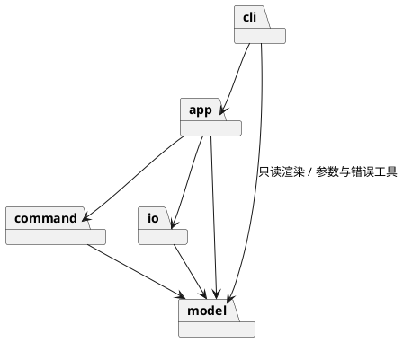

# Lab1 Phase 1：SVG 编辑器（CLI）

Git 仓库地址：<https://github.com/ikou11/svg-editor>（最终提交打了 tag `final`）

用 TypeScript 写的命令行 SVG 编辑器，`npm run cli` 启动。开发时用 Claude Code 协作，代码是分步提交的。

---

## 1. 架构方案

### 1.1 模块划分

代码放在 `src/` 下，分成 5 个目录：

| 模块 | 职责 |
|---|---|
| `model` | 图形和文档本身：`Shape`（抽象）、`LeafShape`、`Rect`/`Circle`/`Ellipse`/`Line`/`Text`、容器 `Group`、`Document`（画布尺寸 + 根容器 + 按 id 查找）、`ShapeFactory`，还有 `Style`、`SvgAttrs`、`ArgReader`、`NumberFormat`、`SvgError`、`ShapeMemento` 几个小类。图形自己负责 move/scale/set，自己说明属性怎么显示（给 tree 和保存用）。这个模块不知道命令、文件、终端。 |
| `command` | 所有可撤销的编辑：`Command` 接口、`History`（undo/redo 两个栈）和 create/delete/move/scale/set/group/ungroup/addto/front/back 对应的命令类。只依赖 `model`。 |
| `io` | SVG 文件的读写：`SvgWriter`（文档转文本）、`SvgReader`（文本转文档，缺 id 时补 id 并产生警告）、`XmlParser`、`FileStore`（唯一碰文件系统的地方）。 |
| `app` | `Editor`：保存当前文档、undo 历史和"io 命令之后不能 undo"这个状态，把界面传来的请求变成 `Command` 去执行。 |
| `cli` | 命令行界面：读一行输入、拆参数、按命令名找到对应的命令类、把结果打印成作业要求的格式（`tree`、`show` 的渲染也在这里）。 |



### 1.2 设计模式的选择

**Command 模式（作业要求）。** 每个编辑命令是一个类，实现 `Command` 接口的 `execute()` 和 `undo()`，两个方法都返回一行给用户看的提示。具体做法：

- 命令在**构造时就做完所有检查**（id 是否存在、`in` 的目标是不是容器等），不合法直接抛错，这样失败时文档不会被改动，也不会进入 undo 栈。`execute`/`undo` 里只做状态修改。
- `History` 有 undo 栈和 redo 栈。执行新命令时清空 redo 栈；redo 就是把命令再 `execute` 一次。
- `group g1 a b c` 是一个 `GroupCommand`，所以撤销一次就全部还原，满足"一条编辑命令 = 一个 undo 单元"。
- `DeleteCommand` 记下原来的父容器和下标，撤销时放回原位。
- `document` 类命令（init/read/save/canvas 改尺寸）不走 Command，由 `Editor` 用一个标志位记录"刚执行过 io 命令"，这时 undo/redo 报错，下一条编辑命令成功后解除。

**Composite 模式。** `Shape` 是统一接口，叶子图形继承 `LeafShape`，`Group` 是容器并持有子节点。`move`/`scale`/`set` 在 `Group` 里递归到子节点，所以命令类里不需要判断是容器还是叶子。

**Memento（快照）。** move/scale/set 三个命令共用基类 `ShapeMutationCommand`：执行前让图形给自己拍快照，撤销时直接还原。没有用"反向操作"（比如 scale 的撤销再乘 1/f），因为浮点数乘回去不一定等于原值。

**Factory（注册制）。** `ShapeFactory` 里是一张"类型名 → 创建函数"的表，不是 `switch`。`create box` 因为没注册，会报 `unknown shape type`。

**Facade。** cli 只和 `Editor` 打交道，不直接创建 `Command`，也不直接读写文件。

**序列化和 tree 的实现方式。** 没有用 Visitor，而是让每个图形自己提供 `tag`、`svgAttributes()`、`describe()` 等方法，`SvgWriter` 和 `TreeRenderer` 只调这些方法。原因是下一阶段要加 `box` 插件，如果用 Visitor，每加一种图形都得改访问者接口。

**按名字分派的两处（待重构）：**

1. 命令分发：`cli/CommandRegistry` 里 `命令名 → CliCommand` 的表。待重构：让命令自己描述并自动注册，help 由注册信息生成。
2. 图形工厂：`model/ShapeFactory` 里 `类型名 → 创建函数`的表（同时存了读 SVG 时用的函数）。待重构：下一阶段改成 `ShapeProvider` 插件接口。

除了这两处，代码里没有 `switch`，也没有按图形类型做 `instanceof`（用测试检查，见后文）。

```plantuml
@startuml
abstract class Shape {
  id; parent
  move(dx, dy); scale(f)
  get(attr); set(attr, v)
  memento()
  describe(); svgAttributes()
}
abstract class LeafShape
class Group { children; add(); remove() }
Shape <|-- LeafShape
Shape <|-- Group
LeafShape <|-- Rect
LeafShape <|-- Circle
LeafShape <|-- Ellipse
LeafShape <|-- Line
LeafShape <|-- Text
Group o-- Shape : children

interface Command { execute(); undo() }
class History { run(); undo(); redo() }
abstract class ShapeMutationCommand
Command <|.. CreateCommand
Command <|.. DeleteCommand
Command <|.. GroupCommand
Command <|.. UngroupCommand
Command <|.. AddToCommand
Command <|.. ZOrderCommand
Command <|.. ShapeMutationCommand
ShapeMutationCommand <|-- MoveCommand
ShapeMutationCommand <|-- ScaleCommand
ShapeMutationCommand <|-- SetCommand
History o-- Command
Editor --> History
Editor ..> Command : 创建
@enduml
```

### 1.3 依赖方向规则

允许的依赖：

```
cli ──> app ──> command ──> model
         │                    ▲
         └──────> io ─────────┘
cli ──> model（只读渲染、参数解析、错误类型）
```

| 规则 | 理由 |
|---|---|
| `model` 不依赖任何其他模块 | 图形和文档是核心，应该能单独测试，也不该知道命令、文件格式或终端。 |
| `command` 只依赖 `model` | 命令只是对模型的操作，不管输入从哪来，也不读写文件。 |
| `io` 只依赖 `model`，和 `command` 互相不依赖 | 文件格式只是模型的一种外部表示，换格式不应该影响命令和界面。 |
| `app` 可以依赖 `command`、`io`、`model`，不能依赖 `cli` | `app` 里没有终端相关的东西，以后换别的界面可以直接复用。 |
| `cli` 只依赖 `app` 和 `model`，不能依赖 `command`、`io`，也不能直接用 `fs` | `cli` 在最外层，必须通过 `Editor` 间接创建命令、读写文件。 |
| 不允许内层依赖外层，不允许循环依赖 | 依赖方向单一，改动的影响范围好判断。 |

违反这些规则的依赖就算待处理项。这些规则我写成了测试（`test/architecture/ArchitectureRules.test.ts`），会扫描 `src` 下所有文件的 import 语句。

### 1.4 变化点假设

| # | 我觉得可能变化的地方 | 为它留了什么（或为什么不留） |
|---|---|---|
| 1 | 新增图形类型（下阶段的 `box`，由插件提供） | `ShapeFactory` 用注册表，命令、保存、tree 都不按类型分支，下阶段把工厂升级成 `ShapeProvider` 就行。`box` 还需要的几个口子（`ungroup` 拒绝复合图形、`set` 把 fill 转发给子图形、tree 里标注类型、保存读回 `data-kind`）这一阶段没做。 |
| 2 | 新增编辑命令 | 加一个 `Command` 类 + 一个 `CliCommand` 类并在 `CommandRegistry` 注册即可。 |
| 3 | 文件格式变化（比如改存 JSON） | 读写都在 `io` 里，`Editor` 只依赖 `SvgReader`/`SvgWriter`/`FileStore`。 |
| 4 | 界面变化（GUI、脚本、agent 调用） | `Editor` 不含终端细节，CLI 只是它的一个前端。 |
| 5 | 更细的 undo 粒度（比如合并命令） | 原来想做一个 `CompositeCommand`，后来没做：现在所有多步操作（group 等）都能放进一个命令类里，提前抽象出来没有人用。 |
| 6 | 图形增加样式属性（opacity 之类） | 样式集中在 `Style` 一个类里，加属性只改这里。没有做"通用属性 Map"，作业只要求 fill/stroke/stroke-width，太通用会破坏封装。 |
| 7 | 用路径（类似 XPath）寻址图形 | 不留。作业说本阶段只用 id；真要加的话只影响 cli 的解析和 `Document` 的查找。 |
| 8 | 读入更多 SVG 元素（path、transform 等） | 不做。读到不支持的元素时打印 `warning` 并跳过，不会悄悄丢掉。 |

---

## 2. 过程记录

下面是开发过程中比较有代表性的几次问题和调整。

**1. 先讨论 Visitor 还是自描述。** 一开始想到 tree 渲染和保存可以用 Visitor，但想到下阶段要加 `box` 插件、要求内核不改，Visitor 每多一种图形就要改访问者接口，所以改成让图形自己提供描述方法。这是在写代码之前定下来的，写进了架构方案。

**2. undo 用快照，不用反向操作。** 设计时就想到 scale 的撤销如果写成再乘 1/f，浮点数可能回不到原值，所以直接让图形拍快照。这个问题没有实际出现过，是提前想到的，但写了一个用 0.1 做缩放因子的测试来保证 undo 后的值和原来完全一样。

**3. AI 提交了一个类型检查没通过的版本。** 写 `GroupCommand` 时 `tsc` 其实报了"属性 doc 声明了但没用"，但 AI 是用 `npm run typecheck | tail` 看结果的，管道让整条命令的退出码变成了 `tail` 的，所以后面的 `git commit` 照常执行了。我们发现之后把字段去掉，用 `git commit --amend` 修正了那个还没推送的提交。之后检查类型不再经过管道。

**4. 批量重命名没生效，但测试还是全绿。** 把 cli 的命令类统一改成 `XxxCliCommand` 时，AI 用了 `sed 's/\bInitCommand\b/.../'`，但 macOS 的 `sed` 不支持 `\b`，结果文件名改了而类名没变。因为文件内部的名字前后一致，测试也都通过，没有任何报错。后来用 `grep "class .*Command"` 发现文件名和类名对不上才看出来，改用 `perl` 重做。这之后我让"一类一文件、文件名等于类名"也进了架构检查测试。

**5. 架构检查测试自己有漏洞。** 写完 `ArchitectureRules` 测试后全部通过，我不想直接相信它，就在 `src/model/SvgError.ts` 里手动加了一行 `import "../cli/Repl.js"`（违反依赖规则），结果测试还是通过——因为正则只匹配了 `from "../xxx/` 这种写法，漏了没有 `from` 的 import。改成匹配所有以 `"../` 开头的字符串后，同样的违规会让测试失败，然后我把那行删掉。

**6. 作业里的示例互相不一致。** 5.1 和第 6 节的 tree 属性列是整棵树对齐的，但 6.1 的树是每组兄弟各自对齐，而且空格数也不统一。我按 5.1 和第 6 节的规则实现（属性列位置 = 最长的"前缀+标签"再加 2 个空格），6.1 的验收测试里把连续空格当成一个来比较。

**7. 作业没规定的地方，自己定了规则。**

- `group` 的新容器放在"文档顺序最靠前的那个成员"原来的位置，子节点保持文档顺序，和命令里写的参数顺序无关。
- 对 `g` 执行 `set` 只接受 `fill`/`stroke`/`stroke-width`，并应用到所有子孙；设几何属性报 `unknown attribute`。
- `line` 的颜色参数对应 `stroke`，tree 里 line 那一行不显示 stroke（和示例一致）。
- 读入不支持的元素（如 `<path>`）、带 `transform` 的 `<g>` 时，打印 `warning` 并继续。
- `init`/`canvas` 只给一个参数时，宽度生效，高度取默认值或保持不变。
- undo/redo 栈为空时报 `nothing to undo` / `nothing to redo`；另外加了一个 `exit` 命令退出。

---

## 3. 一致性自查

### 3.1 模块划分：实际目录与方案是否一致？

目录是一致的：`src/` 下就是 `model`、`command`、`io`、`app`、`cli` 五个目录，每个模块的职责和 1.1 里写的相同。不一致的是模块里具体有哪些类，和最初的方案相比有下面这些变化，都记在了修订记录里：

| 序号 | 变化 | 原因 |
|---|---|---|
| R1 | 取消了计划中的 `CompositeCommand` | group 本身就是一个命令，没有地方用它 |
| R2 | `command` 新增 `ShapeMutationCommand` | move/scale/set 共用"拍快照 → 修改 → 还原"的流程 |
| R3 | `io` 新增 `XmlParser`、`XmlNode`、`SvgReadSession` | 不想引入第三方 XML 库；读入时的状态（已用 id、自动编号、警告）单独成类，保证一类一文件 |
| R4 | `model` 新增 `Style`、`SvgAttrs`、`ArgReader`、`NumberFormat`、`SvgError`、`ShapeMemento` | 分别用来封装样式、读外部属性、解析命令参数、格式化数字、表示用户错误、表示快照 |
| R5 | `ShapeFactory` 里除了创建函数，还登记了"从 SVG 属性构造图形"的函数 | `SvgReader` 读文件时要按标签名创建图形，自己写 `switch` 就多了一个分派点 |
| R6 | cli 的命令类命名为 `XxxCliCommand`；新增 `CommandInterpreter`、`ReplSession`、`LineTokenizer`、`CliApplication`；用 `HelpCliCommand` 代替原来的 `HelpText` | 避免和 `command` 模块里的类重名；把解释器和终端读写分开以便测试；help 内容直接来自注册表，不会和命令列表不同步 |
| R7 | 1.3 里"cli 依赖 model"从"只读渲染"改成"只读渲染、参数解析、错误类型" | 见 3.2 |

### 3.2 依赖方向：方案里的规则有没有被违反？

没有违反。我用 `ArchitectureRules.test.ts` 检查了 `src` 下全部文件（不是只抽样）：每个模块 import 的目标都在 1.3 允许的范围内、模块之间没有环、`cli` 没有 import `command` 和 `io`、只有 `io/FileStore` 用了 `fs`、只有 `cli/Repl` 和 `cli/main` 接触终端。

另外我自己也看了一下 import 的统计：`model` 没有跨模块 import；`command` 和 `io` 都只指向 `model`；`app` 指向 `command`、`io`、`model`；`cli` 指向 `app` 和 `model`。

有一点和最初方案不完全一样：方案写的是 `cli` 对 `model` 只读渲染，但实际上 `cli` 还用了 `model` 里的 `ArgReader`（解析参数）和 `SvgError`（错误类型）。它们是没有状态的小工具，不会让 `cli` 绕过 `Editor` 去改文档，所以我认为可以接受，并把 1.3 的说法改了（R7）。如果要更严格，可以把这两个类放到单独的 `shared` 模块里。

目前留着的待处理项：

- 按名字分派的两处（`CommandRegistry`、`ShapeFactory`）按作业要求保留，下阶段重构。
- `box` 需要的几个口子这一阶段没做（见 1.4 第 1 条）。
- `Document` 按 id 查找是遍历整棵树，作业规模没问题，图形很多时可以在 `Document` 内部加索引。

---

## 4. 质量保证手段

**怎么确认功能是完整的**

1. 把作业第 6 节（典型会话）、6.1 节（两节点流程图）和 5.2 节（show）里的 transcript 原样回放，一行一行比对输出（`test/acceptance/AssignmentTranscripts.test.ts`）。其中有 `other.svg` 的读入和 `warning: assigned id rect1 ...`，也有 `undo not allowed after io command`。
2. 按命令表对每个命令都写了测试：成功时的提示、undo、redo、参数错误、对象不存在。`create` 的六种类型和 `in` 子句也都测了。
3. 作业 4.2 的错误表里每一条都有对应测试（`cannot ungroup composite shape` 要等 `box` 插件，这一阶段没有）。
4. "失败不改变任何状态"：测试里检查失败的 create/set/read/save 之后文档和 undo 栈都没变，而且失败的编辑不会误把 undo 解锁。
5. 往返测试：保存、读回、再保存，两次输出的文本完全一样；`SvgWriter` 对背景知识里的 `flow` 示例输出与文档逐字一致。
6. 用管道输入一段命令脚本，实际运行 `npm run cli`，看输出和保存出来的 SVG 文件；还手动试了一些边界输入（空 id、缺参数、非数字、嵌套 ungroup、save 之后 undo 等）。

**对代码质量有信心的依据**

- 用了 TypeScript 的 strict 模式，另外打开了 `noImplicitOverride`、`noUnusedLocals`、`noUnusedParameters`，`npm run typecheck` 没有报错。
- 测试按模块分层（model、command、io、app、cli），再加验收测试和架构规则测试，`npm test` 当前全部通过（17 个测试文件，137 个用例）。
- 架构规则（依赖方向、一类一文件、没有 `switch`、分派点只有两处）都变成了测试，不是只写在文档里。而且我故意加过一条违规的 import 来确认检查真的会失败（见过程记录第 5 条）。
- 开发是分步提交的，每个模块拆成了好几个小提交，提交前都跑类型检查和测试（过程记录第 3 条是一次漏掉的例外）。

**不足**：没有统计测试覆盖率；交互式终端里的行编辑没有专门测试，主要测的是管道/脚本输入和解释器这一层。
