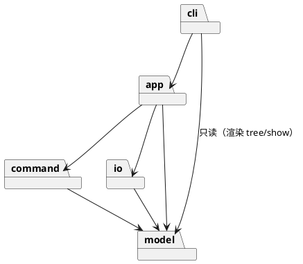

# Lab1 Phase 1：SVG 编辑器（CLI）

> **Git 仓库地址：<https://github.com/ikou11/svg-editor>**
> 最终提交 tag：`final`

技术栈：TypeScript + 面向对象，`npm run cli` 启动 REPL（提示符 `svg>`）。

---

## 1. 架构方案

> 状态：**设计稿（编码前）**。实现完成后在“一致性自查”中对照本节，并在“修订记录”登记偏差。

### 1.1 模块划分

```
src/
├── model/     图形领域模型（Composite）
├── command/   编辑命令与撤销重做（Command）
├── io/        SVG 文件的序列化 / 解析 / 读写
├── app/       应用层：Editor（当前文档 + 历史 + io 锁）
└── cli/       命令行界面：REPL、命令分发、文本渲染
```

| 模块 | 职责 | 主要类（一类一文件） |
|---|---|---|
| `model` | 文档与图形树。不知道命令、文件、终端的存在。图形自己负责几何操作（move/scale/set）与自描述（标签名、属性、树中的摘要行）。 | `Shape`（抽象）、`LeafShape`、`Rect`、`Circle`、`Ellipse`、`Line`、`Text`、`Group`（容器）、`Document`（画布尺寸 + 根容器 + id 索引）、`ShapeFactory`（类型名→类的注册表） |
| `command` | 每个编辑动作是一个可执行、可撤销的对象；`History` 管理两个栈。命令只依赖 `model`。 | `Command`（接口）、`CreateCommand`、`DeleteCommand`、`MoveCommand`、`ScaleCommand`、`SetCommand`、`GroupCommand`、`UngroupCommand`、`AddToCommand`、`ZOrderCommand`、`CompositeCommand`（把一次用户输入内的多个子步骤合成一个 undo 单元）、`History` |
| `io` | 文档 ↔ SVG 文本。序列化只读 `Shape` 的自描述接口，不按类型分支；解析通过 `ShapeFactory` 构造图形，缺 id 时补 id 并产生警告。 | `SvgWriter`、`SvgReader`、`FileStore`（文件读写，隔离 `fs`） |
| `app` | 把以上拼起来的会话对象：持有当前 `Document`、`History`、“io 命令后禁止 undo”标志；对外提供“执行编辑 / undo / redo / 文档操作”。 | `Editor` |
| `cli` | 唯一接触终端的模块：读行、解析引号参数、按命令名找到处理器、把结果打印成规定格式。 | `Repl`、`LineTokenizer`、`CommandRegistry`、`CliCommand`（接口）及各命令处理类、`TreeRenderer`、`ShowRenderer`、`HelpText` |

组件图（PlantUML）：



### 1.2 设计模式的选择与落地

| 模式 | 用在哪 | 落地方式 |
|---|---|---|
| **Command（必须）** | 所有编辑命令的执行与撤销 | `Command` 接口：`execute()` / `undo()`。每个具体命令保存**撤销所需的最小快照**（如 `DeleteCommand` 保存被删节点、原父容器、原下标；`MoveCommand` 保存 dx/dy，undo 反向平移）。`History` 持有 undo/redo 两个栈；执行新命令时清空 redo 栈。`group g1 a b c` 这类多步操作用 `CompositeCommand`，保证“一条用户命令 = 一个 undo 单元”。 |
| **Composite** | 图形树 | `Shape` 为抽象组件，`LeafShape` 为叶子，`Group` 为容器并持有子节点。`move/scale/set/delete` 都在 `Shape` 上声明，`Group` 的实现递归子节点，因此对容器和叶子完全一视同仁，命令类中没有任何 `instanceof` 判断。 |
| **Factory（注册制）** | 按类型名创建图形 | `ShapeFactory` 内部是 `Map<typeName, creator>`，类型通过 `register()` 加入，而不是 `switch`。 |
| **自描述（替代 Visitor / switch）** | 序列化与 tree/show 渲染 | `Shape` 提供 `tag`、`svgAttributes()`、`summary()` 等方法，`SvgWriter` / `TreeRenderer` 只调用这些多态方法，不判断具体类型。选择它而不是 Visitor，是因为 Visitor 每增加一种图形就要给接口加方法，与下阶段“插件新增 `box`、内核改动为 0”的目标冲突。 |
| **Facade** | `Editor` | 命令处理类只和 `Editor` 打交道，不直接操作 `History` / `Document` / `io`。 |

**按名字分派的位置（作业要求只允许两处，均标注为待重构）：**

1. **命令分发**：`CommandRegistry` 中 `命令名 → CliCommand` 的映射。*待重构*：后续可改为命令自描述并自动注册（含 help 文本生成）。
2. **图形工厂**：`ShapeFactory` 中 `类型名 → 创建函数` 的映射，以及 `SvgReader` 用标签名调用它。*待重构*：下阶段升级为 `ShapeProvider` 插件接口，由插件注册类型名、参数 schema、序列化标记。

除这两处外，不允许出现 `switch(tag)` / `if (type === ...)`。

### 1.3 依赖方向规则

允许的依赖（箭头表示“可以依赖”）：

```
cli ──> app ──> command ──> model
         │                    ▲
         └──────> io ─────────┘
cli ──> model（仅只读渲染）
```

| 规则 | 理由 |
|---|---|
| `model` **不依赖任何其他模块** | 领域核心必须可独立测试、可复用；图形不应知道命令、文件格式或终端。 |
| `command` 只依赖 `model` | 命令是对模型的操作，不应关心输入来自 CLI 还是以后的 GUI/脚本，也不应读写文件。 |
| `io` 只依赖 `model` | 文件格式是模型的一种外部表示；换成 JSON 等格式不应触及命令或界面。`io` 与 `command` **互不依赖**。 |
| `app` 可依赖 `command`、`io`、`model`，**不依赖 `cli`** | `app` 是不含 I/O 终端细节的应用核心，以后可被别的界面复用。 |
| `cli` 依赖 `app`（以及只读使用 `model` 做渲染） | `cli` 是最外层。禁止 `cli` 直接创建 `Command` 或直接读写文件，必须经 `Editor`。 |
| **任何内层不得依赖外层**；模块间**无循环依赖** | 保证变更方向单一，便于抽样检查。 |

违反上述规则的依赖视为**待处理项**，在一致性自查中逐条核对（计划用 `import` 语句的 grep 抽查，必要时加 `dependency-cruiser` 做自动检查）。

### 1.4 变化点假设

| # | 最可能的变化 | 为它留了什么 | 或：为何不留 |
|---|---|---|---|
| 1 | **新增图形类型**（下阶段 `box` 复合图形，由插件提供） | `ShapeFactory` 注册制 + `Shape` 自描述接口；命令、序列化、tree 渲染都不按类型分支。下阶段把工厂升级为 `ShapeProvider` 即可。 | — |
| 2 | **新增编辑命令** | `Command` 接口 + `CommandRegistry` 注册；新增命令只加一个类并注册。 | — |
| 3 | **文件格式变化**（如改存 JSON） | `io` 模块独立，`Editor` 只依赖读写接口。 | — |
| 4 | **用户界面变化**（GUI / 脚本 / agent 调用） | `app.Editor` 不含终端细节，CLI 只是它的一个前端。 | — |
| 5 | **更精细的 undo 粒度**（如命令合并） | `CompositeCommand` 已支持多步合并为一个单元。 | — |
| 6 | **图形增加样式属性**（如 opacity、stroke-dasharray） | 暂不留通用属性包。 | 作业只要求 fill/stroke/stroke-width；过早做“万能属性 Map”会削弱封装，需要时再在 `Shape` 上加字段即可。 |
| 7 | **按路径（XPath 式）寻址图形** | 暂不留。 | 作业明确本阶段只用 id 寻址；若以后需要，只会影响 `cli` 的解析层与 `Document` 的查找方法。 |

---

## 2. 过程记录

> 随开发持续补充：记录从 AI 的建议、文档或代码中发现的问题，以及如何确认和纠正。

（待补充）

---

## 3. 一致性自查

> 实现完成后填写，对照第 1 节。

1. **模块划分**：实际目录与方案是否一致？不一致处是否已记入修订记录？（待填）
2. **依赖方向**：方案中的规则是否被违反？抽样检查结果。（待填）

### 修订记录

（待补充）

---

## 4. 质量保证手段

（待补充：测试策略、覆盖的命令与错误场景、对照第 6 节 transcript 的验收脚本等。）
